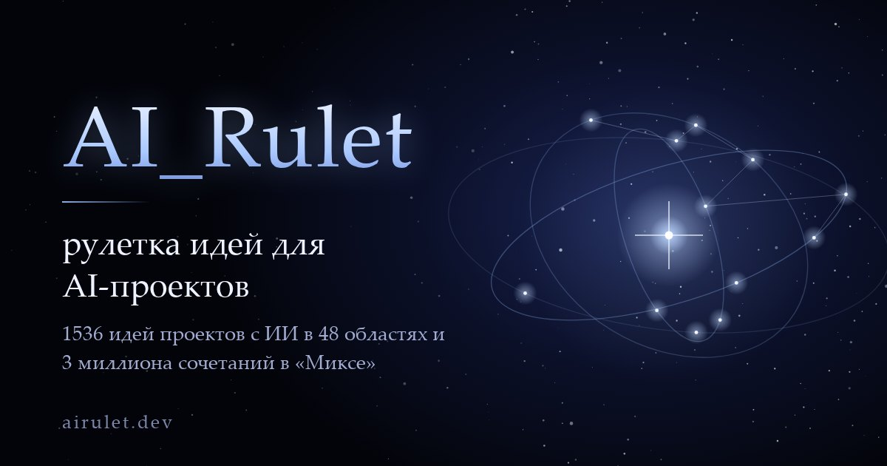

# AI_Rulet — AI project ideas roulette

**[airulet.dev](https://airulet.dev/)**

[](https://airulet.dev/)

Press “Find”, and an idea for an AI project arrives from the depths of space: a task that one or two developers can take to a prototype, with a description, a technology stack and the first steps.

- **Catalog**: 1,536 curated ideas in 48 areas, from LLM agents, RAG and computer vision to medicine, agriculture and accessibility. Each idea has its own path to a prototype and an extra challenge for those who want more.
- **Mix**: about 3 million ideas assembled on the fly from a field of life, an AI technique, a product format and a challenge. Only compatible parts are combined.
- In the catalog, ideas never repeat until the whole deck has been dealt. History, saved ideas with Markdown export, and a share link for every idea.
- Works offline. Every language is a single self-contained HTML page with no external requests, accounts or tracking. Your data stays in your browser’s localStorage.

## Languages

[Русский](https://airulet.dev/) · [English](https://airulet.dev/en/) · [中文](https://airulet.dev/zh/) · [हिन्दी](https://airulet.dev/hi/) · [العربية](https://airulet.dev/ar/) · [فارسی](https://airulet.dev/fa/) · [עברית](https://airulet.dev/he/)

Ideas tied to a language or country, such as NLP tools, speech, law or local realities, are adapted for each language rather than translated word for word.

## Build

```sh
python3 build.py
```

Requires Python 3 and Node.js. The script assembles `index.html` (Russian) and `<lang>/index.html` from `src/`:

- `src/template.html`: layout, styles and code shared by all languages;
- `src/shared/mix.js`: the structure of the Mix;
- `src/lang/<lang>/`: texts of one language (`strings.js`, `page.json`, `help.html`, `catalog.js`, `mix.js`).

It also writes `sitemap.xml` and `robots.txt`.

## О проекте

AI_Rulet — рулетка идей для проектов с ИИ: 1536 идей в 48 областях и около 3 миллионов сочетаний в «Миксе». Работает без интернета и без регистрации. Русская версия — [airulet.dev](https://airulet.dev/).

## License

[MIT](LICENSE)
